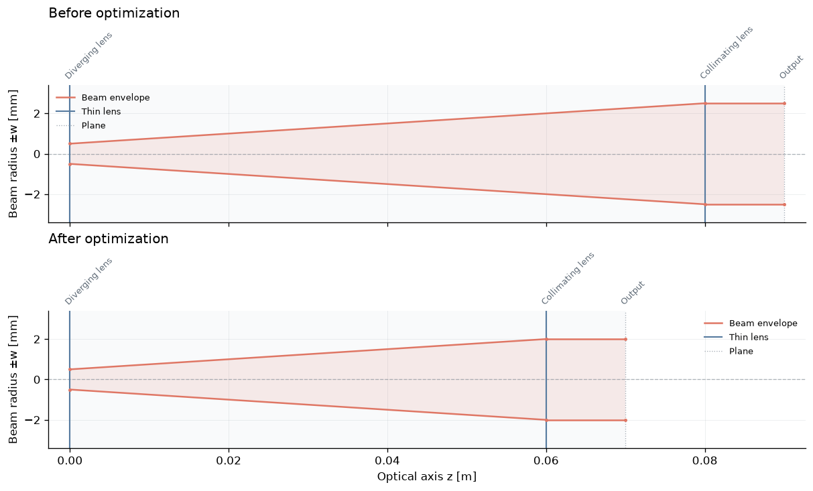

# Expand a Gaussian beam

Expand a 1064 nm Gaussian beam from a radius of 0.5 mm to about 2 mm. A negative
lens causes the beam to spread. A second lens reduces its divergence.

## Run the example

[View the full script on GitHub](https://github.com/JKKDY/diffractix/blob/main/examples/beam_expander.py).

```console
python examples/beam_expander.py
```

The walkthrough below shows selected parts of the script.

## Choose what to vary

Keep the first focal length at −20 mm. Let the solver adjust the spacing and the
second focal length. Measure the output after a 10 mm drift.

```py
--8<-- "examples/beam_expander.py:setup"
```

## Match radius and divergence

Target both the output radius and one quarter of the input divergence.
The radius alone can match while the beam is still spreading too quickly.
Limit total length to 100 mm and keep the beam radius at each lens below one
quarter of its clear diameter. These limits check clearance in the model.
They do not simulate clipping.

```py
--8<-- "examples/beam_expander.py:targets"
```

## Read the result

Compare the expansion factor and divergence in the printed output. A typical
solve gives about 4× expansion and a divergence of about 0.169 mrad. The lens
spacing is about 60 mm, and the total length is about 70 mm.

```py
--8<-- "examples/beam_expander.py:results"
```


