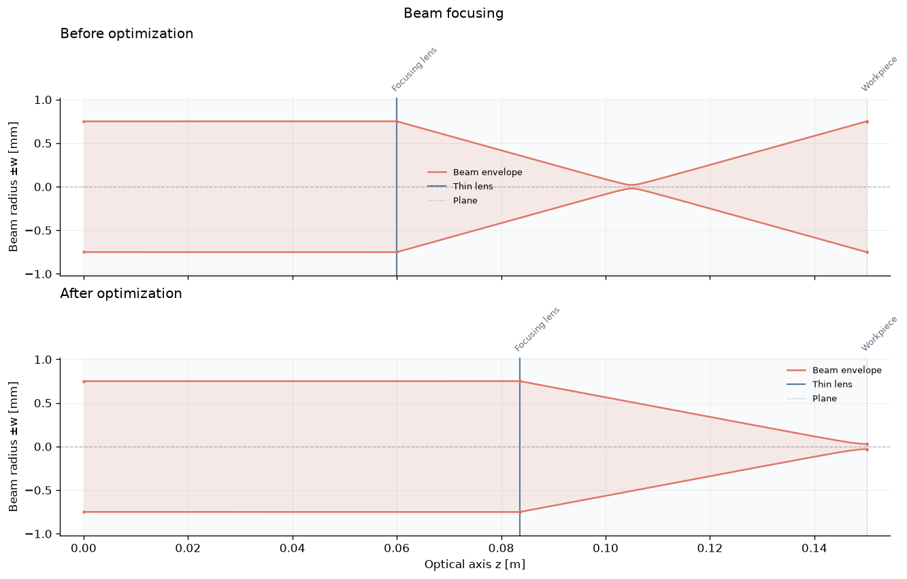

# Focus a Gaussian beam

Focus a 1064 nm Gaussian beam to a waist radius of 30 µm at a workpiece 150 mm
from the source. The solver adjusts the lens position and focal length.

## Run the example

[View the full script on GitHub](https://github.com/JKKDY/diffractix/blob/main/examples/beam_focusing.py).

```console
python examples/beam_focusing.py
```

The walkthrough below shows selected parts of the script.

## Keep the workpiece fixed

Define the working distance as `SYSTEM_LENGTH - input_gap.d`. Moving the lens
changes both gaps in opposite directions. Require at least 50 mm between the
lens and the workpiece.

```py
--8<-- "examples/beam_focusing.py:setup"
```

## Set the focus targets

At the workpiece, target the beam radius and a zero waist offset. A beam can
have the right radius at a plane while its waist is somewhere else. The waist
offset target uses the target beam's Rayleigh range as its scale. This is the
distance from the waist over which the beam's cross-sectional area doubles.
The solver also checks beam radius and divergence at the lens.

```py
--8<-- "examples/beam_focusing.py:targets"
```

## Read the result

Compare the before and after plots and check both the spot radius and the waist
offset in the printed results. The script also reports the radius 2 mm on either
side of the workpiece to show how sensitive the spot is to placement.

```py
--8<-- "examples/beam_focusing.py:results"
```


