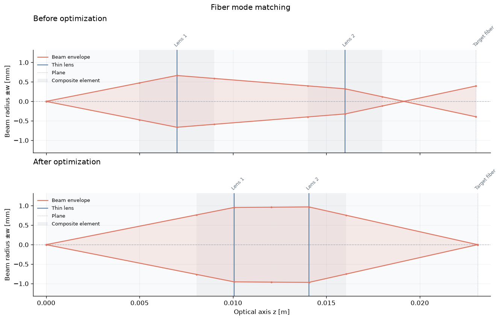

# Match two fiber modes

Couple a Gaussian beam between two single-mode fibers at 1550 nm. Their mode
field diameters are 10.4 µm and 9.2 µm.

## Model the lens packages

Each package is a composite made of a thin lens between two equal spaces. Its
length stays fixed while its focal length can vary.

```py
--8<-- "examples/fiber_mode_matching.py:package"
```

## Build the assembly

The solver adjusts the two focal lengths and three air gaps.

```py
--8<-- "examples/fiber_mode_matching.py:setup"
```

## Match the target mode

At the target fiber face, match the target mode radius and put the waist on
the face. Keep the assembly within 30 mm and add a penalty for length beyond
25 mm. Beam radius and divergence limits apply at each lens.

```py
--8<-- "examples/fiber_mode_matching.py:targets"
```

## Read the result

Use `overlap_with(target_mode)` on the beam at the target fiber to compare
coupling before and after optimization. A typical run gives nearly 100% overlap
in the Gaussian model. This metric describes mode matching and does not account
for losses such as reflections or clipping.

```py
--8<-- "examples/fiber_mode_matching.py:results"
```



## Run the example

[View the full script on GitHub](https://github.com/JKKDY/diffractix/blob/main/examples/fiber_mode_matching.py).

```console
python examples/fiber_mode_matching.py
```
