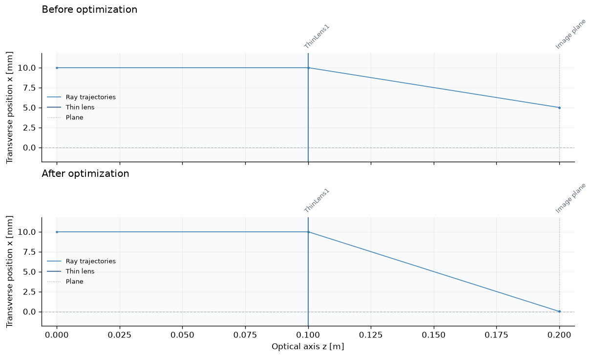

# Focus a ray

Find the focal length that brings a ray onto the optical axis at an image plane.
The ray starts 10 mm above the axis and travels parallel to it.

## Set up the design

Place the thin lens at 100 mm and the image plane at 200 mm. Pass these absolute
positions to `System.add()`. When you build the system, Diffractix inserts the
spaces before the lens and between the lens and the plane.

```py
--8<-- "examples/readme_example.py:setup"
```

## Choose a focal length

Mark the lens focal length as variable, with bounds of 50 to 500 mm. Use
`sim[image_plane].after.x` in a solver target to ask for zero ray height.
The scale is 10 mm, so a miss of 10 mm gives a residual with magnitude one.

```py
--8<-- "examples/readme_example.py:target"
```

## Read the result

The focal length changes from 200 mm to about 100 mm, the distance from the lens
to the image plane. The image height changes from 5 mm to about 0 mm.
Use `solution.value(lens.f)` to read the optimized focal length and
`solution.run()` to trace the optimized ray.

```py
--8<-- "examples/readme_example.py:results"
```



## Run the example

[View the full script on GitHub](https://github.com/JKKDY/diffractix/blob/main/examples/readme_example.py).

```console
python examples/readme_example.py
```
