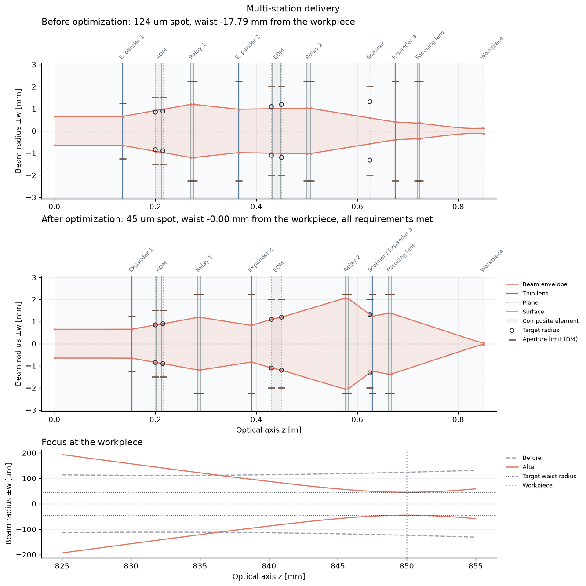

# Deliver a beam to several stations

Send a 1064 nm Gaussian beam through two modulators and a scanner, then focus it
to a 45 µm waist at a workpiece. The stations have fixed positions. The model
treats the modulator crystals as passive slabs.

## Run the example

[View the full script on GitHub](https://github.com/JKKDY/diffractix/blob/main/examples/multistation_delivery.py).

```console
python examples/multistation_delivery.py
```

The walkthrough below shows selected parts of the script.

## Model the modulators

Each crystal sits between two air gaps. As the crystal thickness changes, both
gaps adjust to keep the module length fixed.

```py
--8<-- "examples/multistation_delivery.py:module"
```

## Separate fixed stations from adjustable optics

Place the modulators, scanner, and workpiece at absolute positions. Use
variable parameters for the six lens positions, then let Diffractix fill the
gaps during build. The solver can also vary the negative focal lengths, the
radii and thicknesses of the thick lenses, and the crystal thicknesses.

```py
--8<-- "examples/multistation_delivery.py:layout"
```

## Set the beam targets

Set beam-radius targets at the stations and target both the spot radius and
waist position at the workpiece.

```py
--8<-- "examples/multistation_delivery.py:targets"
```

## Enforce the design limits

Use hard constraints for aperture clearance,
divergence, and minimum distances. For example, the working distance is the
workpiece's `z_start` minus the final lens's rear surface `z_end`.

```py
--8<-- "examples/multistation_delivery.py:limits"
```

## Read the result

Check that the solver reports convergence and that all requirements hold.
Compare station radii and the focus in the before and after plots.

```py
--8<-- "examples/multistation_delivery.py:results"
```


