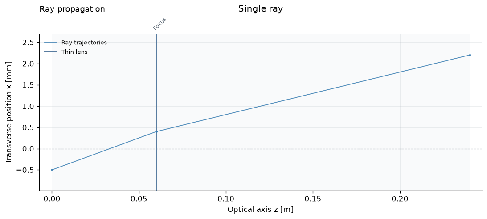
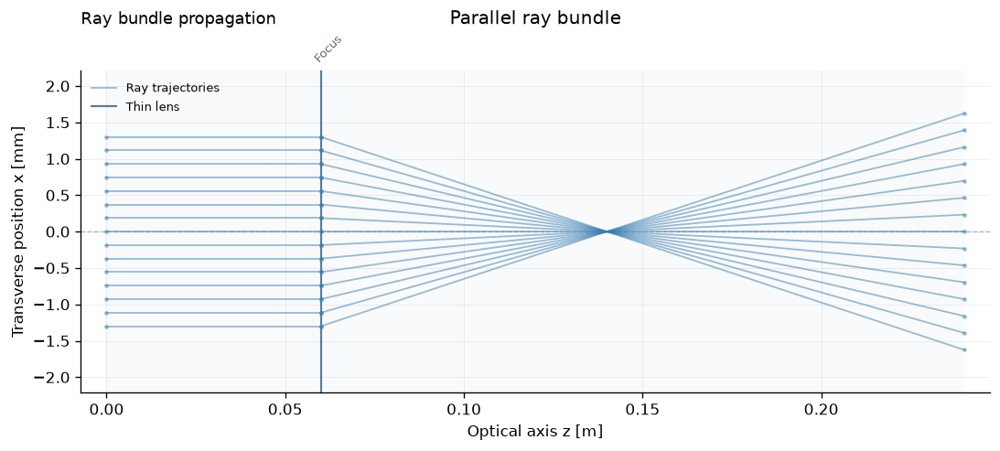
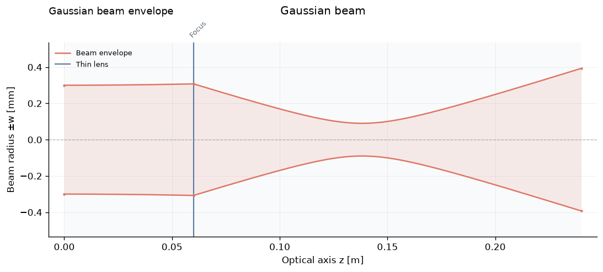

# Plot a propagation trace

Trace a single ray, a parallel ray bundle, and a Gaussian beam through the same
lens system. The lens has a focal length of 80 mm, with 60 mm of free space before
it and 180 mm after it.

## Run the example

[View the full script on GitHub](https://github.com/JKKDY/diffractix/blob/main/examples/plotting.py).

```console
python examples/plotting.py
```

The walkthrough below shows selected parts of the script.

## Make and customize the plots

Build and run a separate system for each source. A single ray gives one path,
the bundle gives 15 paths, and the Gaussian beam gives an envelope. This lets
you compare what each source model tells you about the same layout.

```py
--8<-- "examples/plotting.py:plots"
```

## Display the figures

`system.build().run().plot()` returns the Matplotlib figure and axes. The script
sets a title on each axes and calls `plt.show()` once to display all three
figures. You can use `figure.savefig("trace.png")` to save a figure.

```py
--8<-- "examples/plotting.py:display"
```






