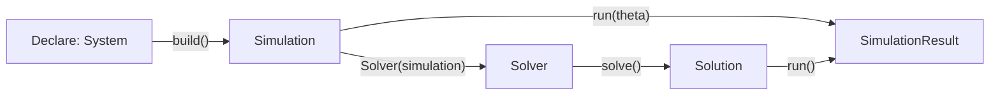

# How Diffractix works

Diffractix answers two questions about a paraxial optical system: where does the light
go, and which design makes it go where you want? It answers the first by propagating a
ray, a ray bundle or a Gaussian beam through the system with ABCD matrices. It answers
the second with gradient-based optimization over the parameters you mark as variable.

This page gives the whole picture. The pages that follow go into each part in detail.

## The four steps

Every use of Diffractix follows the same four steps: **declare**, **build**, **run**
and **solve**.



| Step | You write | You get |
| --- | --- | --- |
| Declare | elements, a source, parameters and requirements, collected in a `System` | a description of the design |
| Build | `system.build()` | a `Simulation`: the design compiled into a function of the variables |
| Run | `simulation.run()` | a `SimulationResult`: the light before and after every element |
| Solve | objectives and constraints on a `Solver`, then `solver.solve()` | a `Solution`: the optimized variables and a report |

The steps are separate on purpose. Declaring is ordinary Python and computes nothing.
Building checks the design once and compiles it, so running and solving are fast and
can be repeated. Solving does not change the objects you declared; it returns its
results in a `Solution`.

## An example

A collimated laser beam, 0.75 mm in radius, is to be focused to a 30 um spot on a
workpiece 150 mm away. A lens sits between the two. Its position and focal length are
free, and it must stay at least 50 mm from the workpiece.

**Declare** the source, the elements in order along the axis, and the requirement:

```python
from diffractix import GaussianBeam, Plane, Solver, Space, System, ThinLens, units
from diffractix.units import mm, nm, um

source = GaussianBeam.from_waist(w0=0.75 * mm, wavelength=1064 * nm)
gap = Space(d=60 * mm, label="Gap").variable(d=(40 * mm, 100 * mm))
lens = ThinLens(f=45 * mm, label="Lens").variable(f=(35 * mm, 110 * mm))
working = Space(d=150 * mm - gap.d, label="Working distance")
workpiece = Plane(label="Workpiece")

system = System(gap, lens, working, workpiece, source=source)
system.require(working.d >= 50 * mm)
```

The working distance is not a number but an expression, `150 * mm - gap.d`. Whatever
value the optimizer gives the gap, the workpiece stays at 150 mm.

**Build** the system and **run** it with the starting values:

```python
simulation = system.build()
result = simulation.run()
print("Spot radius:", units.format(result[workpiece].after.w, um))
```

```text title="Output"
Spot radius: 750.1 um
```

**Solve** for a 30 um spot radius, with the beam's waist on the workpiece:

```python
sim = simulation.symbolic
solver = Solver(simulation)
solver.target(value=sim[workpiece].after.w, target=30 * um)
solver.target(value=sim[workpiece].after.z0, target=0.0, scale=1 * mm)
solution = solver.solve()

print("Gap:", units.format(solution.value(gap.d), mm))
print("Focal length:", units.format(solution.value(lens.f), mm))
print("Spot radius:", units.format(solution.run()[workpiece].after.w, um))
```

```text title="Output"
Gap: 83.54 mm
Focal length: 66.43 mm
Spot radius: 30 um
```

## The optical model

Light is described by a **state** at one position on the optical axis: a `Ray` (a
height and an angle), a `RayBundle` (many rays) or a `GaussianBeam` (its complex beam
parameter `q`). An **element** transforms a state with its ABCD matrix: a `Space`
propagates it, a `ThinLens` focuses it, an `Interface` refracts it into another medium.
A **composite**, such as a `Telescope` or a `ThickLens`, is a group of elements used as
one.

A system is a single sequence of elements along one axis, starting at the source.
Running it applies each element in turn and records the state before and after every
element. All values are in SI units; `diffractix.units` provides constants such as
`mm` to write them readably.

## Parameters and the graph

The numbers in a design are not plain floats. Each one is a **parameter**: a value that
is fixed unless you mark it variable, optionally with bounds. Arithmetic on
parameters, such as `150 * mm - gap.d`, builds an **expression**, and a comparison,
such as `working.d >= 50 * mm`, builds a **constraint**. Diffractix records these as a
graph of operations instead of computing them straight away.

The graph is what makes the build step possible. When you call `build()`, Diffractix
reads the graph once and:

- gives each variable parameter one entry in a vector, `theta`. The optimizer only sees
  `theta`, so a relation such as the working distance holds by construction;
- turns fixed parameters into constants and checks every constraint that no longer
  depends on a variable. A violated one fails the build with an error that names it,
  before any optimization starts;
- compiles the propagation, and later the objectives and constraints, into programs
  that evaluate quickly and that the backend can differentiate.

The requirements of a design are therefore part of the design, are checked before any
optimization, and cost little to evaluate many times.

## Numbers and expressions in results

`simulation.run()` returns numbers: the beam radius at the workpiece is a float.
`simulation.symbolic` has the same structure, but returns expressions:
`sim[workpiece].after.w` is the beam radius at the workpiece as a function of `theta`.
Objectives and constraints are made from these expressions. A function of the result,
such as `lambda sim: sim[workpiece].after.w`, works as well; Diffractix turns it into
an expression where it can.

## Derivatives and backends

Optimization needs derivatives of the objectives and constraints with respect to
`theta`. Diffractix computes them by automatic differentiation, with one of two
numerical backends: Autograd, which is always installed, or JAX, which is optional and
faster on larger problems. Your code is the same with either.

## Where to go next

- [Declaring a system](declaring.md): elements, composites, sources and placement.
- [Parameters and expressions](parameters.md): variables, bounds, shared and derived
  values, requirements.
- [Building](building.md): what `build()` checks and produces.
- [Running and reading results](results.md): looking up states, plotting.
- [Solving](solving.md): objectives, constraints, optimizers and the solution.
- [Backends](backends.md): choosing Autograd or JAX, and writing custom code.
